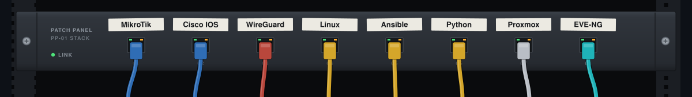
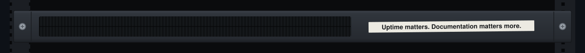

<div align="center">
  
  
</div>

<br />

### `rahmat-core# show version`


Focusing on resilient **network architecture**, **routing & switching**, and **infrastructure automation**. I design, simulate, and deploy high-availability networks—bridging traditional hardware topologies with modern Linux and cloud-native environments.

```ini
[system.identity]
user       = "Abdul Rahmat"
handle     = "@abdulrahmat-network"
specialty  = ["Routing & Switching", "Network Security", "Linux Infrastructure"]
```

<br />

### `rahmat-core# show interfaces status`


| **Network & Routing** | **Security & Tunneling** | **SysAdmin & Automation** | **Simulation & Virtualization** |
| :--- | :--- | :--- | :--- |
| `MikroTik RouterOS` | `Firewall Filtering` | `Linux (Debian/Ubuntu)` | `EVE-NG` |
| `Cisco IOS / NX-OS` | `WireGuard / IPsec` | `Docker & Containers` | `GNS3` |
| `OSPF` · `BGP` · `MPLS` | `VLAN / QinQ` | `Ansible` · `Bash` | `Proxmox VE` |
| `VRRP / Failover` | `Zero Trust Access` | `Python Netmiko` | `Wireshark` |

<br />


### `rahmat-core# show lldp neighbors`

[GitHub](https://github.com/abdulrahmat-network) &nbsp;·&nbsp; [LinkedIn](https://www.linkedin.com/in/your-handle) &nbsp;·&nbsp; [Email](mailto:you@example.com
<br />
  
  <br />
  <sub><code>root@abdulrahmat-network:~# exit</code></sub>
  
</div>

