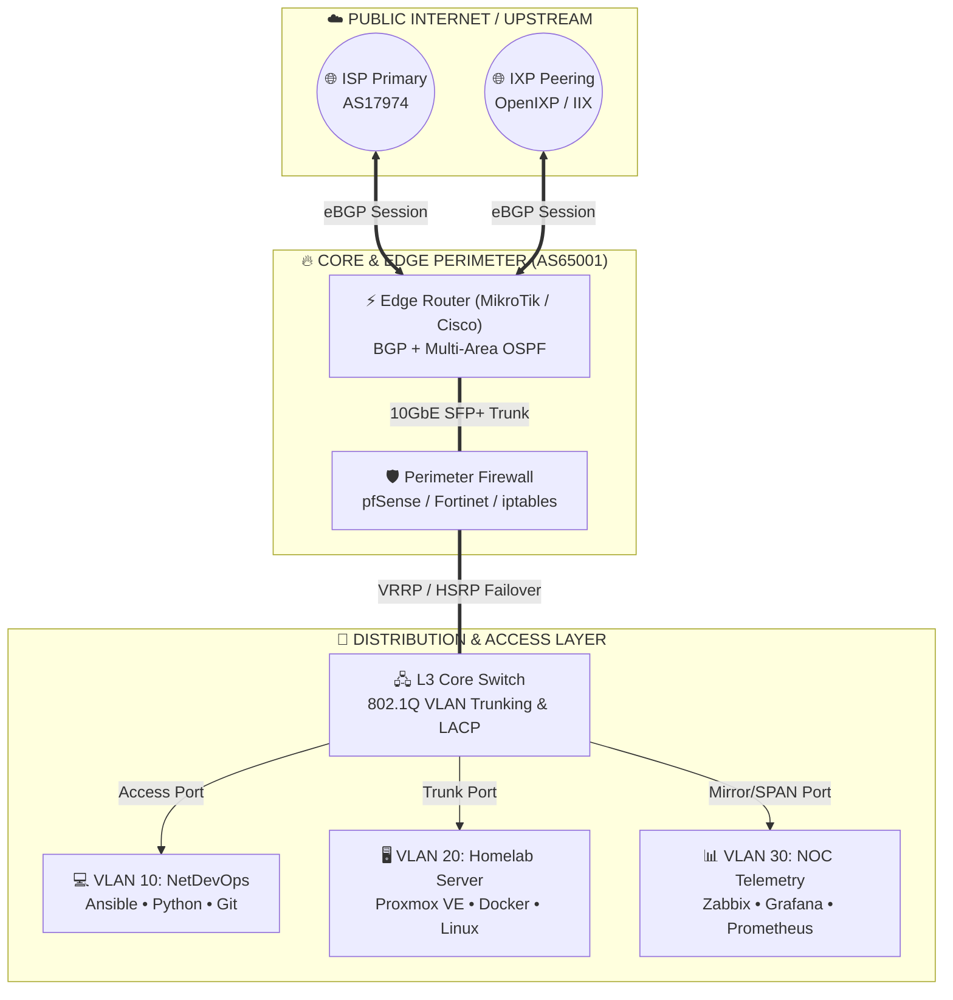

<div align="center">
🌐 `ABDUL RAHMAT // AS65001-NET`
Network Engineer • Infrastructure Architect • NetDevOps Enthusiast
`[ STATUS: ONLINE ]` `⚡ [ UPTIME: 99.999% ]` `🛡️ [ FIREWALL: ACTIVE ]` `📡 [ BGP: ESTABLISHED ]`
</div>
```diff
+ =============================================================================== +
+  root@abdulrahmat-network:~# systemctl status network-engineer.service          +
+  ● network-engineer.service - Abdul Rahmat Core Routing & Infrastructure Daemon +
+     Loaded: loaded (/etc/systemd/system/abdulrahmat.service; enabled)           +
+     Active: active (running) — 0% packet loss | MTU 1500 | Full-Duplex 10Gbps   +
+ =============================================================================== +
- [!] ALERT: Unauthorized boring profiles will be dropped by iptables rule #01    -
```
---
🗺️ `show cdp neighbors detail` — Interactive Network Topology
> 💡 *Diagram di bawah ini otomatis di-render secara interaktif oleh GitHub (bisa di-zoom & digeser).*

---
💻 `Interactive CLI Terminal` — Klik Perintah untuk Menjalankan!
> 👇 **Klik baris perintah di bawah ini** untuk membuka *output* konfigurasi dan *packet capture* secara interaktif:
<details open>
<summary><b>🟢 <kbd>RUN</kbd> <code>$ whois abdulrahmat-network --verbose</code></b> <i>(Klik untuk buka/tutup profil)</i></summary>
<br>
```yaml
network_identity:
  hostname: "Abdul Rahmat"
  handle: "@abdulrahmat-network"
  asn_lab: "AS65001"
  specialization:
    - "Enterprise Routing & Switching (OSPF, BGP, MPLS, VLAN, STP)"
    - "MikroTik RouterOS & Cisco IOS/IOS-XE Configuration"
    - "Network Security, VPN Tunneling (WireGuard, IPsec, OpenVPN) & Hardening"
    - "Linux System Administration & Network Automation (Python, Bash, Ansible)"
  mission: "Membangun arsitektur jaringan yang zero-downtime, aman, dan terotomatisasi."
```
</details>
<details>
<summary><b>⚡ <kbd>RUN</kbd> <code>$ traceroute -I abdulrahmat-network.github.io</code></b> <i>(Klik untuk lacak rute paket)</i></summary>
<br>
```text
traceroute to abdulrahmat-network.github.io (192.0.2.1), 30 hops max, 60 byte packets
 1  lo0.homelab.local (10.0.0.1)                     0.184 ms  0.152 ms  0.140 ms
 2  vlan100-gw.mikrotik-ccr.net (172.16.10.1)        0.892 ms  0.845 ms  0.811 ms
 3  xe-0/0/0.core-cisco-asr.backbone.id (100.64.0.1) 1.412 ms  1.389 ms  1.355 ms
 4  abdulrahmat-network (192.0.2.1)                  1.337 ms  [ICMP ECHO REPLY: REACHABLE]
```
</details>
<details>
<summary><b>📦 <kbd>RUN</kbd> <code># show inventory | include Tech-Stack</code></b> <i>(Klik untuk lihat persenjataan jaringan)</i></summary>
<br>
Layer / Kategori	Protokol, Vendor & Tools	Status Kemahiran
L2 / Switching	`802.1Q VLAN` `STP / RSTP` `LACP / EtherChannel` `LLDP / CDP`	`██████████ 95%`
L3 / Routing	`Static` `OSPFv2/v3` `BGP` `PBR` `VRRP / HSRP` `MPLS`	`█████████░ 90%`
Network Vendors	`MikroTik (RouterOS v6/v7)` `Cisco IOS` `Juniper Junos` `Ubiquiti`	`█████████░ 90%`
Security & VPN	`Firewall Filter/NAT/Mangle` `WireGuard` `IPsec` `pfSense` `ZeroTier`	`████████░░ 85%`
Virtualization & Lab	`EVE-NG` `GNS3` `Cisco Packet Tracer` `Proxmox VE` `Docker`	`█████████░ 90%`
Monitoring & NetDevOps	`Wireshark` `Nmap` `Zabbix` `Grafana` `Linux CLI` `Python` `Ansible`	`████████░░ 80%`
</details>
<details>
<summary><b>🦈 <kbd>RUN</kbd> <code># tcpdump -i eth0 -nn -vvv port 179 or port 8291</code></b> <i>(Klik untuk intip trafik)</i></summary>
<br>
```diff
14:02:11.402198 IP (tos 0xc0, ttl 1, id 49102, length 60)
+ 10.255.255.1.179 > 10.255.255.2.48192: Flags [P.], cksum 0x8f2a (correct), BGP KEEPALIVE
14:02:12.110492 IP (tos 0x0, ttl 64, id 10293, length 52)
+ 192.168.88.254.51234 > 192.168.88.1.8291: Flags [S], Winbox Session Authenticated (User: abdulrahmat)
- 185.220.101.45.44122 > 203.0.113.10.22: Flags [S], SSH Brute-Force Attempt -> DROPPED BY FIREWALL RAW
```
</details>
---
🗂️ `show ip route` — Featured Network Labs & Repositories
Port / Repo	Deskripsi Proyek & Topologi	Protokol & Stack	Status
📁 enterprise-isp-topology	Simulasi jaringan ISP & Enterprise dengan redundancy penuh, Multi-Area OSPF, eBGP/iBGP Peering, dan VRRP failover.	`BGP` `OSPF` `VRRP` `EVE-NG`	🟢 `UP`
⚡ mikrotik-routeros-arsenal	Kumpulan script `.rsc` siap pakai untuk QoS Bandwidth Management (PCQ/Queue Tree), Dual-WAN Failover Recursive, & Firewall Hardening.	`RouterOS v7` `Scripting`	🟢 `UP`
🤖 netdevops-automation	Otomatisasi backup konfigurasi router dan deployment VLAN massal menggunakan Python & Ansible.	`Python` `Netmiko` `Ansible`	🟡 `LAB`
🖥️ homelab-infra-docs	Dokumentasi server homelab berbasis Proxmox VE, manajemen kontainer Docker, Reverse Proxy, dan Monitoring Zabbix/Grafana.	`Proxmox` `Linux` `Docker`	🟢 `UP`
---
📈 `show interfaces telemetry` — Live Animations & Dynamic Widgets
> 🔥 **Cara Mengaktifkan Animasi Bergerak di GitHub:**
> Saat kamu menempelkan (*paste*) isi file ini ke repositori `abdulrahmat-network/abdulrahmat-network` di GitHub, **salin dan lepaskan kode HTML di dalam kotak di bawah ini** ke bagian paling atas dan bawah `README.md` kamu untuk memunculkan:
> 1. **Efek Ketikan Terminal Otomatis (Typing SVG)**
> 2. **Gelombang Header Cyberpunk (Animated Wave)**
> 3. **Grafik Trafik Jaringan Aktivitas Commit (MRTG/Grafana Style Graph)**
> 4. **Skill Icons & GitHub Stats Card**
```html
<!-- 1.TEMPELKAN INI DI BAGIAN PALING ATAS README UNTUK BANNER GELOMBANG & EFEK KETIKAN TERMINAL -->
<div align="center">
  

  <a href="https://github.com/abdulrahmat-network">
    
  </a>
</div>

<!-- 2. TEMPELKAN INI DI BAGIAN TECH STACK UNTUK IKON ANIMASI VENDOR & TOOLS -->
<div align="center">
  
</div>

<!-- 3. TEMPELKAN INI DI BAGIAN TELEMETRY UNTUK GRAFIK TRAFIK JARINGAN & STATS REAL-TIME -->
<div align="center">
  
  
  
  
</div>
```
---
🤝 `ping abdulrahmat-network` — Establish 3-Way Handshake
Ingin berdiskusi soal desain topologi, troubleshooting routing, peering, atau kolaborasi proyek infrastruktur? Kirimkan paket `SYN` kamu melalui port komunikasi berikut:
<div align="center">
Protocol / Port	Endpoint Destination	Status
💼 LinkedIn (Port 443)	linkedin.com/in/abdul-rahmat	`LISTENING`
📧 SMTP / Email (Port 587)	`abdulrahmat@domain.com`	`LISTENING`
💬 Telegram / Discord	`@abdulrahmat`	`ONLINE`
</div>
```text
--- abdulrahmat-network.github.io ping statistics ---
4 packets transmitted, 4 received, 0% packet loss, time 3004ms
rtt min/avg/max/mdev = 0.812/1.337/1.902/0.118 ms
```
